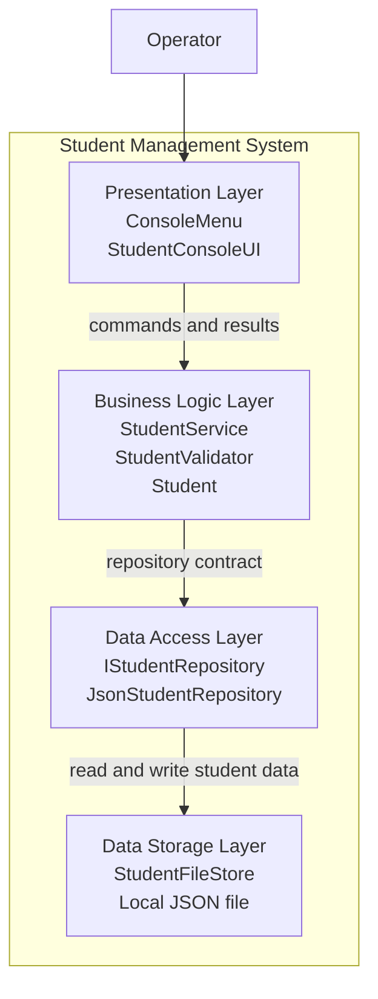
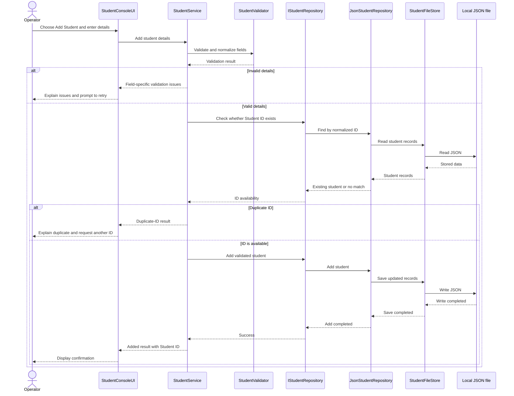

# Student Management System — Architecture

## 1. Project Architecture Overview

The Student Management System is a .NET 10 console application organized into four simple layers. Each layer has a focused responsibility and communicates only with the layer below it. The Business Logic Layer depends on a repository interface, not on file-handling details.

The project currently targets `net10.0` and enables nullable reference types and implicit usings. The classes in this document describe the proposed design; they are not yet implemented.

### Design principles

- Keep console input/output separate from business rules and storage.
- Put student rules in one place so all operations apply them consistently.
- Use a repository interface to keep the business layer independent of JSON and files.
- Begin with a local JSON file and a single operator, as assumed by [REQUIREMENTS.md](./REQUIREMENTS.md).
- Report errors clearly; never treat failed or corrupted storage as an empty successful result.

## 2. Layer-wise Responsibilities

### 2.1 Presentation Layer

**Responsibility:** Provide the console menu, collect and format operator input, and display results.

This layer calls the business layer to perform operations. It does not validate business rules itself, enforce unique IDs, or read and write files. It may perform simple input parsing needed to collect values, then rely on the business layer for authoritative validation.

### 2.2 Business Logic Layer

**Responsibility:** Implement student-management use cases and enforce student rules.

This layer validates student data, coordinates add/list/search/update/delete operations, preserves the immutable Student ID rule, and responds to duplicate or missing records. It depends on `IStudentRepository`, not on a specific persistence implementation.

### 2.3 Data Access Layer

**Responsibility:** Provide the repository implementation that translates business-level requests into storage operations.

The repository looks up students, returns them in stable ascending Student ID order, and ensures IDs remain unique when adding records. It works with the storage layer and keeps JSON/file concerns out of the business layer.

### 2.4 Data Storage Layer

**Responsibility:** Read and write the persistent representation of student records.

For the first implementation, this layer stores records in a local JSON file. It handles file access and JSON serialization/deserialization, but does not make business decisions such as whether an email is valid.

## 3. Component Descriptions

| Component | Layer | Responsibility |
|---|---|---|
| `ConsoleMenu` | Presentation | Displays available actions, reads the menu selection, and routes the operator to the corresponding UI workflow. |
| `StudentConsoleUI` | Presentation | Prompts for student details and IDs; formats student records, confirmations, empty states, validation feedback, and errors for display. |
| `StudentService` | Business Logic | Implements add, list, search, update, and delete use cases by applying rules and coordinating repository calls. |
| `StudentValidator` | Business Logic | Checks required names and ID, trims surrounding whitespace where required, validates optional dates and email, and returns actionable validation issues. |
| `Student` | Business Logic | Represents a student and the fields defined in the requirements: ID, first and last name, date of birth, email, phone, enrollment date, and program/course. |
| `IStudentRepository` | Business Logic boundary | Defines the student persistence operations needed by the service without specifying how data is stored. |
| `JsonStudentRepository` | Data Access | Implements the repository contract using the file-storage component; applies case-insensitive ID matching and stable listing order. |
| `StudentFileStore` | Data Storage | Reads and writes the local JSON file and reports file or serialization failures. |

Keep the initial design to these components. Add separate result types or smaller services only if the implementation becomes difficult to understand or test.

## 4. Class Responsibility Matrix

| Class or contract | Owns | Must not own |
|---|---|---|
| `ConsoleMenu` | Menu display, selection, and operation routing | Student validation or persistence |
| `StudentConsoleUI` | Gathering input and presenting operation outcomes | Business decisions or direct file access |
| `StudentService` | Use-case coordination and business rules | Console prompts, JSON serialization, or file paths |
| `StudentValidator` | Student-field validation and actionable validation messages | Console reads or storage access |
| `Student` | Student data and its basic representation | Menu flow or file operations |
| `IStudentRepository` | Contract for adding, listing, finding, updating, and deleting students | JSON or filesystem implementation details |
| `JsonStudentRepository` | Repository behavior, ID uniqueness, and stable ordering | User interaction or field-format validation |
| `StudentFileStore` | JSON serialization and physical file reads/writes | Student use-case decisions or console messages |

## 5. Application Execution Flow

1. The application starts and creates the required components in its composition root (`Program.cs`).
2. The composition root supplies `StudentFileStore` to `JsonStudentRepository`, the repository to `StudentService`, and the service to the presentation components.
3. `ConsoleMenu` displays the available operations and reads a selection.
4. The selected presentation workflow gathers any required input and calls `StudentService`.
5. The service validates input and invokes `IStudentRepository` for the requested operation.
6. The repository accesses `StudentFileStore`; returned data or an operation outcome travels back through the same layers.
7. The presentation layer displays a success, not-found, empty-state, validation, or error message.
8. The menu is shown again until the operator chooses to exit.

An invalid menu selection produces a message and returns to the menu. Exiting does not discard successfully persisted changes.

## 6. Student Registration Flow

The repository must also enforce uniqueness during the add operation itself, not only in a separate lookup. This protects the invariant if another code path calls the repository directly. The application is scoped to a single operator, so multi-process concurrency control is not part of this initial design.

## 7. Data Storage Strategy

- **Format:** A local JSON file containing the collection of student records.
- **Location:** Use a documented, configurable path rather than relying on the process's current working directory. The chosen default should be stated in the operator documentation.
- **Initialization:** If the file does not exist on first run, initialize an empty store. If an existing file is malformed or cannot be read, report the problem; do not silently replace it with an empty collection.
- **Integrity:** Normalize Student IDs by trimming surrounding whitespace and compare them case-insensitively. Enforce uniqueness in the repository before saving.
- **Ordering:** Return students in ascending Student ID order for a stable display.
- **Safe writes:** Write the complete new content to a temporary file in the same directory, then replace or move it into place where supported. Clean up the temporary file after a failed write where possible. Report a failure rather than claiming success.
- **Scope:** This simple file-based approach matches the single-operator, local-storage assumption. If concurrent access or larger data volumes become requirements, replace the storage implementation (for example, with a database) behind the repository contract.

The requirements expect add, update, and delete to be all-or-nothing. The implementation should therefore prepare the complete updated collection before writing and only report success after the replacement has completed.

## 8. Dependency Injection Strategy

Use constructor injection so each component receives the collaborators it needs rather than creating them internally. `Program.cs` acts as the composition root and is responsible for connecting concrete implementations:

- Create `StudentFileStore`.
- Give it to `JsonStudentRepository`.
- Pass the repository to `StudentService` through the `IStudentRepository` contract.
- Pass the service to the presentation components.

For a beginner-friendly console project, manual composition in `Program.cs` is sufficient and avoids adding a DI-container dependency. This is still dependency injection: dependencies are supplied from outside each class. If the application later adopts a DI container, register `IStudentRepository` to resolve to `JsonStudentRepository` and register the service and presentation components there. The business layer should continue depending only on the repository interface.

## 9. Error Handling Strategy

- Treat invalid field values, duplicate IDs, and missing records as expected operation outcomes. Return clear results to the presentation layer so it can prompt again or explain the outcome.
- Handle expected file access and JSON serialization/deserialization failures at the storage boundary and communicate them upward as meaningful storage errors.
- Do not silently catch and ignore exceptions. Do not claim an operation succeeded if persistence failed.
- A failed add, update, or delete must leave the previous stored data intact as far as the file-replacement strategy permits.
- Malformed persisted data must be reported and must not be interpreted as a valid empty store.
- The presentation layer displays plain-language messages without stack traces or implementation details. Unexpected errors may be handled at the application boundary to prevent an unhandled crash, while retaining diagnostic details for development or logging.
- After a recoverable error, return to a safe point in the workflow, normally the current prompt or main menu.

## 10. Unit Testing Strategy

### Business logic unit tests

Test `StudentService` without using the filesystem by providing a fake or in-memory implementation of `IStudentRepository`. Cover:

- Adding valid students and rejecting duplicate IDs.
- Listing students, including the empty collection, in stable order.
- Searching for existing and missing IDs.
- Updating an existing student's details while preserving Student ID.
- Deleting only the requested student and handling missing IDs.
- Rejecting invalid required fields, dates, and email values.
- Ensuring failed validation does not call repository save operations.

### Validator unit tests

Test `StudentValidator` independently with valid and invalid inputs, including whitespace-only required values, trimmed fields, future dates of birth, invalid dates, and optional email formats.

### Repository and storage tests

Use a unique temporary directory and file for each test. Verify JSON round-tripping, case-insensitive duplicate prevention, sorting, missing-file initialization, and clear handling of malformed JSON and file access failures. These are integration tests because they exercise filesystem behavior.

### Presentation testing

Keep presentation classes thin. Verify the key menu and registration interactions with manual smoke tests or redirected console input/output. If substantial branching develops, isolate it behind testable methods and add focused tests.

### Testability guidelines

- Keep business rules out of `Console.ReadLine`/`Console.WriteLine` workflows.
- Depend on `IStudentRepository` in the service so tests can substitute a fake.
- Avoid shared test data files; clean up each test's temporary storage.
- Assert both the returned outcome and any repository changes, especially for failure cases.
